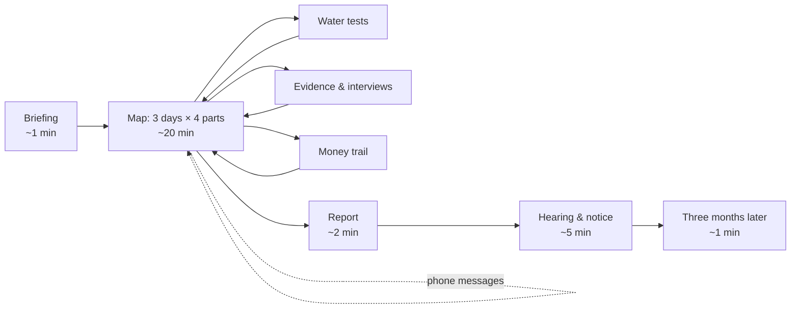

# Comm-Det

## Game Title and Developer
**Comm-Det: Community Detective**
**Developer:** Rainers Ļebedevs, rl23031

## Game Concept
*Comm-Det* is a fully **2D**, UI-based Roblox detective game, with no 3D world or avatar movement. Each case starts with a problem in a small Latvian town that nobody in charge wants to look at. The cause is always a mix of an environmental problem and the people who profit from ignoring it.

The player tests the water, reads documents, interviews witnesses, follows the money and answers difficult messages on their phone. Every choice changes what happens to the river and to the people involved. At the end, the player has to convince the town council in a public hearing.

The social issue is not a quiz attached to a story. It is the detective work itself. A water sample is evidence, a greenwashing claim is a clue, a bribe is a decision, and a clear warning to residents can stop children from getting sick.

## Story / Theme
The player is a new investigator at the **Community Detective Bureau**, a small public-interest bureau in the fictional town of **Vecupe** on the **Dzirnupe** river.

Each case follows the same arc:
1. **Something is wrong.** The player sees the consequence first: dead fish, a sick child, a strange smell at night.
2. **Someone says everything is fine.** A company report, an official test or a council decision covers the problem up.
3. **There is a deadline.** A decision will be made soon, and the evidence has to be ready before then.

The tone is serious noir, suitable for players aged 13–18. Nobody is a cartoon villain. The PR manager is doing his job, the councillor thinks he is helping his family, and the plant really does employ 140 people from the town. The player has to separate what is proven from what only looks suspicious.

## Social Good Theme
The game addresses **water pollution that continues because of corruption and weak oversight**.

A company can keep polluting a river when its own "green" reports go unchecked, official tests are taken only when the water looks clean, a decision-maker has an undeclared financial interest, the people affected never get clear information, and whistleblowers are too afraid to speak.

This is a real problem in our region:
- HELCOM's *State of the Baltic Sea* report found that **eutrophication affects 97% of the Baltic Sea**, mostly because of nutrients carried there by rivers, and estimates the losses at **€3.8–4.4 billion a year**.
- In Transparency International's Corruption Perceptions Index published in February 2026, **Latvia scored 60 and ranked 37th**, the lowest of the three Baltic states.

The game's message is:

> **Check the evidence. Report it to the people who can act. Protect the people who speak up.**

It is connected to four UN Sustainable Development Goals:

- **SDG 6 – Clean Water and Sanitation**
  - **6.3** "…improve water quality by reducing pollution, eliminating dumping and minimizing release of hazardous chemicals and materials…" The player tests the river and finds the source of the pollution.
  - **6.6** "…protect and restore water-related ecosystems, including… rivers…" The River meter and the ending show whether the river recovers.
- **SDG 3 – Good Health and Well-being**
  - **3.9** "…substantially reduce the number of deaths and illnesses from hazardous chemicals and… water… pollution and contamination." A child gets a rash after swimming, and the player decides how families are warned.
- **SDG 12 – Responsible Consumption and Production**
  - **12.6** "Encourage companies… to adopt sustainable practices and to integrate sustainability information into their reporting cycle." The plant's "Green Report" makes promises with no numbers behind them.
  - **12.8** "…ensure that people everywhere have the relevant information and awareness for sustainable development…" The player writes the notice that residents read.
- **SDG 16 – Peace, Justice and Strong Institutions**
  - **16.5** "Substantially reduce corruption and bribery in all their forms." A bribe arrives on the player's phone, and the money trail uncovers a conflict of interest.
  - **16.6** "Develop effective, accountable and transparent institutions at all levels." The evidence only matters if it reaches the institutions that can act on it.
  - **16.7** "Ensure responsive, inclusive, participatory and representative decision-making at all levels." The case ends with a public hearing and a council vote.
  - **16.3** and **16.10**: accusations need evidence, and the person who leaked the hidden data has to be protected.

The game can benefit:
- **teenage players**, who practise reading sustainability claims critically, telling evidence from rumour and reporting wrongdoing safely;
- **communities near rivers and the coast**, because people who know how pollution is found and reported are more likely to notice it and report it to the right place;
- **whistleblowers and local journalists**, because the game shows why anonymity and verified facts matter;
- **rivers, the Baltic Sea and the species living in them**;
- **public institutions** such as the State Environmental Service (VVD), the Corruption Prevention and Combating Bureau (KNAB) and the Health Inspectorate, which many young people have never heard of.

## Social Good Integration into Gameplay
Every learning goal is tied to a mechanic that changes the outcome:

| Learning goal | Mechanic | Why it matters in the game | SDG |
|---|---|---|---|
| A single daytime test can hide pollution | **Water test:** fill the jar, dip the strip, read the colour, label and seal the sample | Only a night sample at the outflow pipe proves where the pollution comes from | 6.3 |
| Compare points to find the source | **River profile:** every sample is added to a chart from upstream to the sea | Clean upstream and high at the pipe means the pollution enters at the pipe | 6.3, 6.6 |
| Spot greenwashing | **Magnifier:** tap suspicious phrases in reports, chats and minutes | "Zero impact" and "100% eco-friendly" become clues. Tapping harmless phrases records false leads | 12.6 |
| A conflict of interest has to be proven, not guessed | **Money trail:** link people, companies and payments on a cork board | Four proven links expose the councillor's brother. Every wrong link counts as an unfair accusation | 16.5, 16.3 |
| Refuse corruption, protect sources | **Phone messages:** four timed messages, three replies each | A refused and saved bribe becomes evidence. Naming the whistleblower costs her the job | 16.5, 16.10 |
| Warn people before it's too late | **Phone and notice:** the worried mother, then the public notice | Clear advice keeps children out of the water. Panic or silence does not | 3.9, 12.8 |
| Know which institution can act | **Final report:** choose the evidence and who receives it | VVD, KNAB and the Health Inspectorate act. "The plant's PR department" and "social media only" do nothing | 16.6 |
| Decisions belong to the public | **Hearing:** object to false statements with clues and keep the room's trust | The council refuses the permit only if the room trusts the player | 16.7 |

At the end, the **"What changed in Vecupe"** list shows eleven outcomes in plain language. Each line explains why it did or did not happen:

| In-game line | SDG |
|---|---|
| Night discharges stopped | 6.3 |
| Less pollution reaching the sea | 6.3 |
| The river is recovering | 6.6 |
| Families kept safe | 3.9 |
| Residents got clear information | 12.8 |
| Greenwashing exposed | 12.6 |
| Corruption reported, bribe refused | 16.5 |
| Rushed permit exposed | 16.6 |
| Nobody accused without evidence | 16.3 |
| Whistleblower kept safe | 16.10 |
| The town decided together | 16.7 |

## Example Case: "Murky Water" (*Duļķainais ūdens*)

### The hook
There have been three fish kills in one week on the Dzirnupe, and children swim at the town beach every day. On **Friday at 10:00** the town council votes on extending the discharge permit of the fertiliser plant **AS "Zaļā Druva"** for ten more years. The plant says every test is within the limit. The player has three days.

### The evidence
| # | Evidence | Hidden clue |
|---|---|---|
| E1 | *Vecupes Ziņas* news article about the fish | A spokesperson says the discharge is "all within the limits", a claim without proof |
| E2 | The town group chat | Several neighbours mention a sharp smell **at night**, and children swim at the beach daily. One message calls Lapsa a thief, a rumour with no evidence |
| E3 | The plant's *Green Report 2026* | "Zero impact on the river" and "100% eco-friendly": big promises with no numbers |
| E4 | Permit and council minutes | The permit was approved in **seven days**. Councillor Lapsa voted in favour and declared no conflict of interest |
| E5 | The official lab summary | All samples were taken **between 10:00 and 14:00**, and the summary was signed by the plant, not the lab |
| E6 *(hidden)* | Jānis's night photos | Cloudy discharge from the pipe at 02:14 |
| E7 *(hidden)* | Anna's original lab sheet | Night samples showed **4.6 mg/L** and were marked "do not include" |
| E8 *(hidden)* | A message from the plant's PR manager | €2,000 for "consulting" and "maybe no need to rush before Friday": a bribe |

### The witnesses
Interviews take time, and some places are only open at certain times of day.

- **Jānis Ozols** (fisherman, 40 years on the river): has noticed that the water turns grey at night, and has photos.
- **Ieva Liepa** (mother of two, lives by the beach): one of her children got a rash after swimming.
- **Anna Bērziņa** (lab technician): knows the night samples were hidden, but is afraid of losing her job.
- **Edgars Kalniņš** (PR manager, AS "Zaļā Druva"): claims all discharge happens during office hours → present the night evidence to catch the lie.
- **Councillor Artūrs Lapsa**: claims the permit went through the normal procedure and that he has no personal interest → present the seven-day approval and the payment to catch both lies.
- **Rita Vanaga** (journalist, *Vecupes Ziņas*): contacts the player by phone and wants to publish now.

### The tools
- **Water test.** Four test kits for four sample points (upstream, the outflow pipe, the farm drain and the beach), by day or by night. The pipe reads 0.5 mg/L by day and **5.0 mg/L at night**, against a permit limit of 1.0. Upstream (0.1) and the farm drain (0.5) rule out other sources.
- **Money trail.** Seven cards on a cork board: two people called Lapsa, two companies, the councillor, the plant and the permit. The company register shows that **SIA "NL Konsultācijas"** belongs to Normunds Lapsa, the councillor's brother, and the plant paid it **€18,000** three days before the permit was approved. Inga Lapsa owns a bakery: same surname, no relation, a true link that proves nothing.

### The decisions
Four phone messages arrive as time passes. Each has a 25-second timer and three replies, and silence is also an answer.
- **Ieva:** "It's warm today and the kids are begging to swim. Is it safe?"
- **Edgars:** the bribe. Accept it, refuse it, or refuse it and save the message as evidence.
- **Anna:** "If the director finds out I gave you that sheet, I'll lose my job." Keep her anonymous or expose her.
- **Rita:** publish now, or wait until the facts are proven.

### The report and the hearing
The player chooses which evidence goes into the report and who receives it: VVD, KNAB, the Health Inspectorate, the plant's PR department, or social media only.

At the hearing, the plant's lawyer **Kārlis Krūmiņš** makes six statements, and one of them is true. For each one, the player objects with a clue or lets it pass:
- the right clue: **+12** trust;
- a clue that doesn't disprove it: **−5**;
- objecting to the true statement: **−10**;
- letting the true statement pass: **+4**;
- letting a false statement pass: **−5**.

Trust starts at 30, and the council refuses the permit only at **60 or more**. Then the player writes the notice to residents from four parts (what we found, what to do now, who is acting and where to get updates). Clear, calm wording raises trust; panic, accusations and vague wording lower it.

### The payoff
**Three months later.** The ending shows the river with or without fish, four meters (**River, Justice, Safety, Trust**), what happened to Jānis, Anna, Ieva and Lapsa, and the "What changed in Vecupe" list.

| Ending | When |
|---|---|
| **Clear Water** | The permit is refused, River is 70 or higher, and Justice and Safety are 60 or higher |
| **Half the Truth** | The permit is refused, but the investigation left gaps |
| **Business as Usual** | The room's trust stayed below 60 and the permit was extended |
| **The Bureau for Sale** | The player accepted the bribe |

## Intended Impact
Players should leave understanding that:
- one daytime test can hide a pollution problem, and comparing points along a river shows where it starts;
- a company's sustainability claims need numbers behind them;
- a conflict of interest has to be proven with documents, and a rumour is not evidence;
- VVD, KNAB and the Health Inspectorate exist, and anyone can contact them;
- whistleblowers need protection, and residents need clear, calm information.

**Measuring progress**
- The ending reached, the four meters and the eleven outcomes, compared between a first and a repeated playthrough.
- The number of **false links** on the money trail and **wrong objections** at the hearing, which shows whether the player is judging evidence or just reacting to suspicion.
- How many players refuse the bribe, protect the whistleblower and warn the families.
- A short anonymous survey after playtests with players aged 13–18.

## Gameplay and Rules
- Single-player, about 30 minutes per case
- Fully 2D, UI-only Roblox experience, playable on desktop and mobile
- Visual style: a detective's desk drawn entirely from UI elements (paper, polaroids, cork board, typewriter text), plus illustrated scenes built from layered gradients
- All in-game text is in English. Names, places and institutions are Latvian.
- **Time budget:** three days with four parts each (morning, afternoon, evening, night). Interviews, water tests and records requests use time, and places are open only at certain times.
- **Mistakes never end the game early.** They cost trust, justice or safety, or lead to a worse but still meaningful ending.
- **Hints:** three per case, for players who are stuck.
- **Built-in tutorial:** short notes the first time the player opens each screen.
- **Sound:** paper, typewriter keys, stamps, a gavel, a phone buzz, river and rain ambience, and quiet piano music. Music and sound effects can be switched off separately.

### Case flow


## What Makes It Exciting
- **A real mystery, not a worksheet.** There is a consequence, a cover-up to uncover and a twist: the samples were only ever taken in daylight.
- **Hands-on investigation.** The water test is physical: hold to fill, time the dip, match the colour by eye, and at night switch on a torch first.
- **Ticking clock.** Three days, four kits and a Friday vote mean the player cannot do everything.
- **Hard choices under pressure.** Phone messages arrive with a timer, and the "easy" answer is often the wrong one.
- **A courtroom finale.** Objecting at the right moment with the right clue moves the room.
- **Visible consequences.** Three months later, the player sees the river, the people and the town that their choices made.
- **Reasons to replay.** Four endings, eleven outcomes, hidden evidence and different routes through the three days.

## Objectives and Progression
Each case is scored on four meters, from 0 to 100:

| Meter | Measures |
|---|---|
| **River** | Was the source proven, inspected and stopped? |
| **Justice** | Was the conflict of interest proven and reported, without unfair accusations? |
| **Safety** | Were families warned clearly, and did the Health Inspectorate act? |
| **Trust** | Did the room believe the player at the hearing? |

The meters decide the ending and the "What changed in Vecupe" list. The best ending, **Clear Water**, needs the full investigation, the right institutions and the town's trust.

## Platform and Development Tools
- **Roblox Studio** and **Luau**
- Roblox UI: `ScreenGui`, `Frame`, `TextButton`, `TextLabel`, `UIGradient`, `CanvasGroup`, `UIScale`, and `TweenService` for animation
- **2D only:** the whole game is drawn in `ScreenGui`s on a 960×540 stage that scales to any screen. The 3D workspace is not used, and there are no image files: every scene, from the desk to the river at night, is built from UI elements.
- **Data-driven cases:** each case is a `ModuleScript` table that holds the locations, sample points, evidence, clues, witnesses, phone messages, the money trail, the hearing and the endings. A new case only needs new data, with no new code.
- **Reusable modules:** `App` (screens, modals, toasts), `UIKit` (paper, pins, stamps, polaroids, threads), `CaseState`, `Audio`, `Art.RiverScene`, and one module per screen
- `SoundService` with separate groups for sound effects and music
- **Free audio from the Roblox Creator Store:** sound effects by Pro Sound Effects and piano music by DistroKid artists
- **GitHub** for documentation, scripts and version control. Scripts are exported from the Studio place file and committed to the repository.

### Project structure
```
ReplicatedStorage
└── CommDet
    ├── Config          -- days, parts of the day, kits, hints, timers
    ├── Theme           -- colours and fonts
    ├── UIKit           -- paper, pins, tape, stamps, buttons, polaroids, threads
    ├── App             -- screen switching, modals, toasts, phone queue, sound switches
    ├── Systems
    │   ├── CaseState   -- everything the player has found and decided
    │   ├── Audio       -- sound effects, ambience and music
    │   └── AIBridge    -- placeholder for AI-assisted interviews
    ├── Art
    │   └── RiverScene  -- the illustrated river for the water test
    ├── Cases
    │   └── MurkyWater  -- the whole case as data
    └── Screens
        ├── Title, Briefing, Map, Sampling, MoneyTrail, Phone
        ├── Viewer, Board, Interview, Report
        └── Hearing, Ending
StarterPlayer
└── StarterPlayerScripts
    └── CommDetClient   -- starts the game
```

## Originality
Environmental games and detective games both exist, but they rarely combine. In most "eco" games, the player plants trees or sorts rubbish, and the problem has no people behind it. In *Comm-Det*, **the evidence is the lesson**: a water sample proves a lie, a company register exposes a conflict of interest, and a clear notice keeps children out of polluted water.

It also focuses on a specific, local and current problem: a river in a small Latvian town, a company that greenwashes, a rushed council decision, and the real institutions that can stop it.

## Scope
The project is solo-developed, so scope is split by phase.

**Prototype 1 (done)**
- The core 2D case engine: a detective's desk built from UI elements, an evidence viewer with phrase tapping, interviews with contradictions, and a case board with red threads
- A reusable, data-driven case system

**Prototype 2 (done)**
- The full *Murky Water* case, playable from the briefing to the ending
- Map with a three-day time budget, the money trail, timed phone decisions, the final report, the public hearing, the residents' notice and four endings
- Hands-on water test in four steps (fill, dip, read, label and seal), a night torch, and a river profile chart
- Illustrated river scenes for every sample point, with day, evening and night lighting
- Sound effects, ambience and music, with separate on/off switches
- Natural Latvian names for characters, companies and the local paper

**Final version (planned)**
- Contradictions for every witness, not only Edgars and Lapsa
- Hands-on versions of the other mechanics, for example pulling red thread between pins on the money trail
- Saved progress, so a case can be continued later
- A phone layout pass and a playtest with players aged 13–18
- Optional AI-assisted interviews using Roblox's text generation, short and clearly labelled
- A second, shorter case

## Sources
- United Nations, *The 17 Goals*: https://sdgs.un.org/goals
- HELCOM, *State of the Baltic Sea* report: https://helcom.fi/helcom-state-of-the-baltic-sea-report-despite-improvements-the-baltic-sea-is-not-yet-in-a-good-state/
- LSM, *Latvia shows little change in corruption index* (10 February 2026): https://eng.lsm.lv/article/society/crime/10.02.2026-latvia-shows-little-change-in-corruption-index.a633889/

*Vecupe, the Dzirnupe river, AS "Zaļā Druva" and every character in the game are fictional. Any resemblance to real people or companies is coincidental.*
