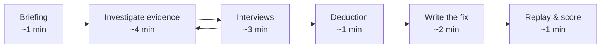

# Comm-Det

> *Somebody wrote a message. Nobody understood it. Something went wrong.*
> *Your job: find out what happened, and write the message that fixes it.*

## Game Title and Developer
**Comm-Det: Communication Detective**  
**Developer:** Rainers Ļebedevs, rl23031

## Game Concept
*Comm-Det* is a fully **2D**, UI-based Roblox detective game, with no 3D world or avatar movement. Each case starts with a real-life failure: an empty workshop, a missed bus, a family argument. The cause is always a message that someone misunderstood.

The player investigates chat logs, emails and photos, interviews witnesses, catches contradictions, and reconstructs **what was really said and how it was misunderstood**. Only then can they write a corrected message, and watch what happens when it is sent.

The language skill is not a quiz attached to a story. It is the detective work itself. Finding an unclear phrase is finding a clue, and writing a clear message is closing the case.

## Story / Theme
The player is a new cadet at the **Communication Detective Bureau** (*Komunikācijas detektīvu birojs*), a small agency that is called whenever words cause trouble in schools, group chats and local communities.

Each case follows the same arc:
1. **Something went wrong.** The player sees the consequence first.
2. **A message is the suspect.** It has been forwarded, shortened, translated or misread along the way.
3. **There is a deadline.** The same event happens again soon, and the message has to be fixed before then.

The tone is light and a little humorous, closer to a cosy mystery than a crime drama. Nobody is the villain. The person who wrote the bad message usually had a good reason, such as being in a hurry or thinking nobody reads long texts.

## Social Good Theme
The game addresses the decline of confident Latvian communication among young people, including frequent and unconscious mixing of English and Latvian.

The game's message is **not** "English is bad" or "slang is wrong". It is:

> **Say it so that your reader understands, and pick your words for who is reading.**

Slang in a friends' chat is fine. The same message forwarded to parents, grandparents, younger students or someone still learning Latvian can cause real problems. The game teaches players to notice this difference.

It is connected to:
- **SDG 4 – Quality Education:** builds vocabulary, reading comprehension and the ability to write clearly for a purpose.
- **SDG 10 – Reduced Inequalities:** shows how unclear messages exclude people such as older relatives, younger students and Latvian learners, and gives players the tools to include them.
- **SDG 11 – Sustainable Cities and Communities:** encourages active use of Latvian and better communication between generations and within local communities.

The game can benefit students, teachers, families and Latvian-speaking communities, and teachers can use it as a 10-minute classroom activity.

## Social Good Integration into Gameplay
Every learning goal is tied to a mechanic that affects the outcome:

| Learning goal | Mechanic | Why it matters in the game |
|---|---|---|
| Notice unclear or inappropriate wording | **Magnifier:** tap suspicious phrases in evidence | Each correct find is a clue. Flagging fine wording costs reputation. |
| Understand that meaning depends on the reader | **Interviews:** each witness misread the same message differently | The player learns *why* each phrase failed for *that* person |
| Separate real problems from prejudice | **Deduction:** choose the real causes of the failure | "Because it used English words" is a trap answer |
| Know clear Latvian alternatives | **Detective's Dictionary:** every solved clue adds an entry | It is collectible and reviewable after the case |
| Adapt register to the audience | **Message Builder:** write the same facts for two different audiences | One message for the class chat and one for parents |
| See that clarity has consequences | **Replay of the event:** characters react to *your* message | The player sees who shows up and who still gets lost |

## Example Case: "The Empty Workshop" (*Tukšā darbnīca*)

### The hook
The school robotics teacher, **Ilze Kalniņa**, expected 20 students for Thursday's robotics workshop. Only 3 came. On Friday there is one last workshop. If the school cannot form a team of 6 by Friday evening, it **misses the national robotics competition**. The player has until then to find out what went wrong.

### The evidence
| # | Evidence | Hidden clue |
|---|---|---|
| E1 | Ms Kalniņa's original email to the class chat admin. It is long and formal, but it contains every fact: date, time, room, what to bring | The source of truth. All correct facts come from here |
| E2 | The version posted in the class chat by student **Markuss**: *"Workshop tmrw after lessons @ lab, bring ur stuff, maybe 15:00ish"* | The **timestamp is 00:07 on Thursday**. Markuss meant Thursday, but anyone reading it in the morning thought "tmrw" meant Friday |
| E3 | Parents' group chat. Emīls's mother writes: *"Kas ir workshop? Kurā lab?"* Nobody answers | Shows the message failing for a different audience |
| E4 | School floor plan | There are **three** labs: chemistry, physics and IT (lab 4). "@ lab" names none of them |
| E5 | Timetable | 8th graders finish at 14:10 and 11th graders at 15:00, so "after lessons" means different times for different classes |
| E6 *(hidden)* | Markuss's draft in his notes app: the full version, deleted with the comment *"neviens tik garu nelasīs"* ("nobody will read this much") | Optional clue that explains his motive and unlocks an extra interview |

### The witnesses
The player has **time for 3 of the 4 interviews**. Finding E6 earns a 4th.

- **Ilze Kalniņa** (teacher): stressed and honest. Confirms the facts and the stakes.
- **Markuss** (11th grade, chat admin): defensive. Claims *"I wrote the time clearly."* → present **E2 ("15:00ish")** to catch the contradiction.
- **Emīls** (8th grade): went to the **chemistry lab at 14:15**, waited, and left. Two problems at once: "after lessons" and "@ lab".
- **Daniela** (10th grade, in her second year of learning Latvian): her translator turned "bring ur stuff" into nonsense, and she did not know what to bring, so she stayed home.

### The deduction
*"Why did only 3 students come?"* The player picks the real causes:

- "Tomorrow" was ambiguous because the message was sent after midnight
- The room was not specified, and there are three labs
- "After lessons" means a different time for each grade
- It was unclear what to bring
- Students are not interested in robotics *(the evidence contradicts this)*
- The message contained English words *(a trap: the problem was clarity for the reader, not English as such)*

### The fix
The player builds **two messages from text blocks**. Correct blocks only unlock if the player found the matching fact in the evidence.

**For the class chat** (informal is fine):
> Robotikas darbnīca ir **piektdien, 23.10., plkst. 15.00, 4. laboratorijā (2. stāvā)**. Ņemiet līdzi klēpjdatoru un lādētāju

**For the parents' group** (polite and complete):
> Labdien! Piektdien, 23. oktobrī, plkst. 15.00 4. laboratorijā (2. stāvā) notiks robotikas darbnīca. Lūdzu, atgādiniet bērniem paņemt līdzi klēpjdatoru un lādētāju. Paldies! Ilze Kalniņa

Each slot (*greeting what when where what to bring signature*) offers 3–4 options: one clear, one vague, one with a wrong fact and one in the wrong register. Using the informal version in the parents' group loses points. Using the formal one in the class chat is acceptable, just a little stiff.

### The payoff
**Friday, 15:00.** The game replays the event using the player's messages. Students appear in lab 4 one by one, and each witness reacts. Emīls finds the right room, Daniela brings her laptop, and Emīls's mother replies *"Paldies, sapratu!"* If the message was still unclear, someone ends up in the wrong place, and the player sees exactly who and why. If 6 or more students arrive, the team is formed and the case is closed.

## Intended Impact
Players should leave understanding that:
- clear, context-appropriate Latvian prevents real misunderstandings;
- the same message can be fine for one reader and fail for another;
- short and clear are not opposites, because the correct class chat message is short.

**Measuring progress**
- Case scores across the four criteria below, which can be compared between first and repeated playthroughs.
- The number of **false flags**, which shows whether the player is judging clarity or just reacting to English words.
- An optional 3-question warm-up before the case and a similar check after it, for classroom use.

## Gameplay and Rules
- Single-player, 8–12 minutes per case
- Fully 2D, UI-only Roblox experience, playable on desktop and mobile
- Visual style: flat 2D illustrations (character portraits, evidence cards, chat screenshots, a lab background), similar to a visual novel or *Papers, Please*
- All in-game text is in Latvian. The interface uses large buttons and short text blocks.
- **Mistakes never end the game.** They give feedback, cost reputation, or lead to a worse but still interesting ending.
- **Time budget:** interviews and some actions cost in-game time, so the player chooses where to investigate. This is turn-based and has no real-time pressure.

### Case flow

## What Makes It Exciting
- **A real mystery, not a worksheet.** There is a consequence, a cause to uncover and a twist (the midnight timestamp).
- **Ticking clock.** Friday's deadline and a limited interview budget mean the player's choices matter.
- **Visible consequences.** The player watches the event happen again because of the message *they* wrote.
- **Characters with motives.** Markuss is not a villain. He shortened the message for a reason most players will recognise.
- **Reasons to replay.** A hidden clue, a bonus interview, three-star ratings and a dictionary to complete.

## Objectives and Progression
Each case is scored on four criteria, from 1 to 3 stars each:

| Criterion | Latvian label | Measures |
|---|---|---|
| Investigation | *Izmeklēšana* | Clues found, contradictions caught, false flags avoided |
| Accuracy | *Precizitāte* | Correct facts (date, time, place, items) in the final messages |
| Clarity | *Skaidrība* | No ambiguous phrases remain |
| Appropriateness | *Piemērotība* | The right register for each audience |

Stars add up to detective ranks:
**Kadets** → **Detektīvs** → **Vecākais detektīvs** → **Vecākais komunikācijas detektīvs** (all 12 stars).

## Platform and Development Tools
- **Roblox Studio** and **Luau**
- Roblox UI: `ScreenGui`, `Frame`, `TextButton`, `TextLabel`, `ImageLabel`, `UIListLayout`, `TweenService` for transitions
- **2D only:** the whole game is drawn in a `ScreenGui`. Characters, rooms and evidence are 2D images, and the 3D workspace is not used.
- **Data-driven cases:** each case is a `ModuleScript` table that holds the evidence, clues, dialogue, deduction options and message blocks. A new case only needs new data, with no new code.
- **Reusable UI modules:** `EvidenceViewer`, `InterviewPanel`, `DeductionBoard`, `MessageBuilder`, `ReplayScene`, `ResultsScreen`
- `DataStoreService` saves stars, rank and dictionary progress
- **GitHub** for documentation, scripts and version control

## Originality
Language-learning games and detective games both exist, but they rarely combine. In most language games, the language is the test and the story is decoration. In *Comm-Det*, **the language is the evidence**: misunderstood phrases are clues, readers with different backgrounds are witnesses, and a well-written message changes how the story ends.

It also focuses on a specific, local and current problem: everyday Latvian youth communication in chats, where English mixing and missing context cause real misunderstandings.

## Scope
The project is solo-developed, so scope is split into must-haves and stretch goals.

**Minimum version (must have)**
- One complete, polished case: *The Empty Workshop*
- Evidence viewer with phrase tapping, 4 interviews with a time budget, deduction, message builder for 2 audiences, results screen
- Text-based replay of the event (characters' reactions shown as cards)
- Reusable, data-driven case system

**Stretch goals**
- Animated 2D replay scene (character portraits sliding into a lab illustration with `TweenService`)
- Contradiction mechanic in all interviews, not only Markuss's
- Detective's Dictionary as a separate reviewable screen
- Saved progress and ranks
- A second case, for example *The Missed Bus* (a grandmother misreads a grandson's voice-to-text message) or *The Neighbourhood Clean-up* (a community event poster that nobody understands)
